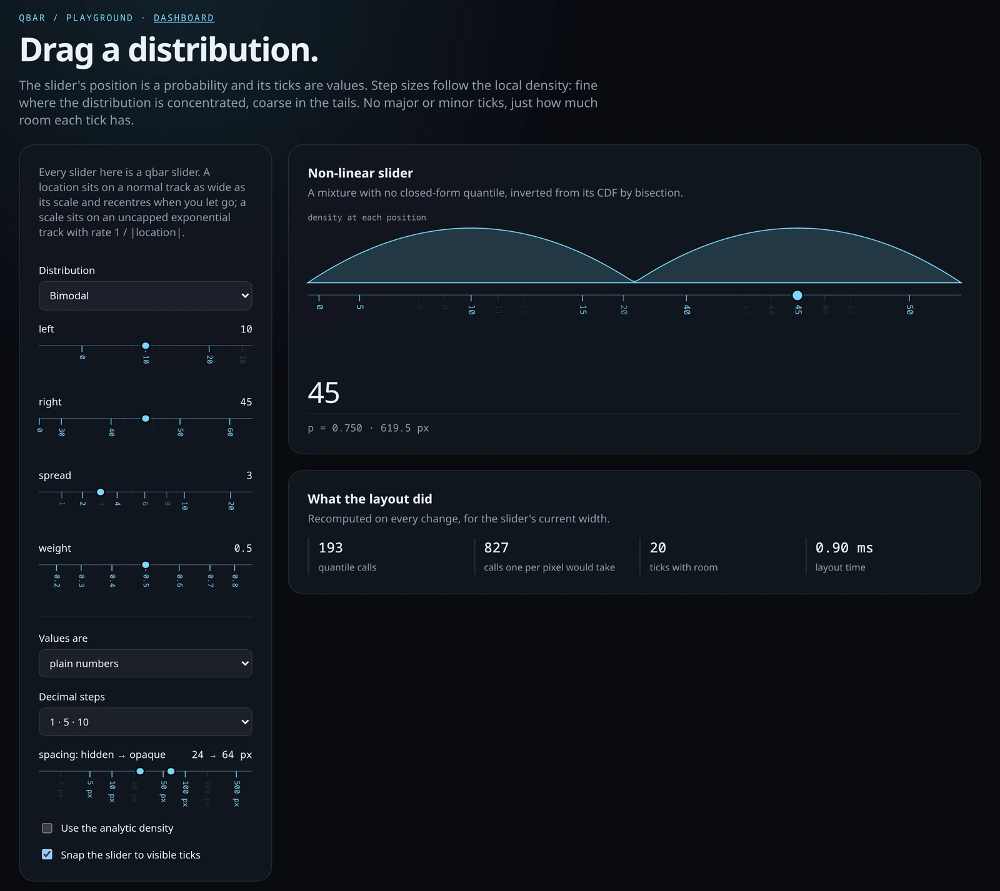
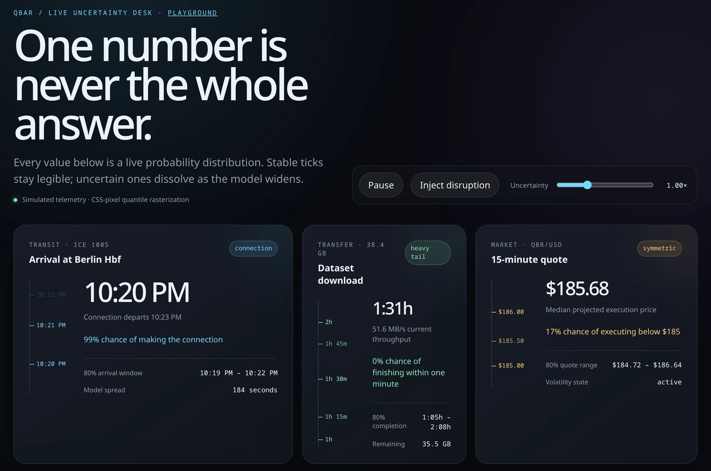

# qbar

[](https://github.com/khoda81/qbar/actions/workflows/ci.yml)
[](https://khoda81.github.io/qbar/playground)
[](https://www.npmjs.com/package/@qbar/qbar)
[](LICENSE)

**Density-aware ticks for anything laid out by a quantile function.**

A qbar maps position to probability and lets the values become the ticks.
Where a distribution is concentrated, values spread out and fine steps appear;
in the tails they compress and only coarse steps survive. There are no "major"
and "minor" ticks, only a spectrum of steps and how much room each tick has.

The same idea gives you uncertainty bars for ETAs and forecasts, log and other
non-linear sliders, range sliders, and axes for any monotone mapping.

[](https://khoda81.github.io/qbar/playground)

**[Try the playground →](https://khoda81.github.io/qbar/playground)** ·
[Live dashboard](https://khoda81.github.io/qbar/)

## Quick start

```sh
bun add @qbar/qbar # or: npm install @qbar/qbar
```

`<q-bar>`, `<q-slider>` and `<q-range>` are framework-independent web
components. Give them a quantile function and a scale:

```ts
import { decimalTicks, durationTicks } from "@qbar/qbar";
import { defineQBar, defineQSlider } from "@qbar/qbar/element";

defineQBar();
defineQSlider();

// An ETA: exponential with a 4-minute mean. Durations are in milliseconds.
const eta = document.querySelector("q-bar")!;
eta.quantile = (p) => -240_000 * Math.log1p(-p);
eta.scale = durationTicks();

// A log slider from 0.1 to 100.
const gain = document.querySelector("q-slider")!;
gain.quantile = (p) => 0.1 * 1000 ** p;
gain.scale = decimalTicks({ multipliers: [1, 2] });
gain.value = 5;
gain.addEventListener("input", () => console.log(gain.value, gain.label));
```

<!-- prettier-ignore -->
```html
<q-bar></q-bar>
<q-slider orientation="horizontal" snap></q-slider>
```

qbar is pre-1.0, so minor versions may still change the API.

## The core

Everything above is built on one function:

```ts
import { decimalTicks, layoutTicks } from "@qbar/qbar";

const ticks = layoutTicks({
  quantile: (p) => model.quantile(p), // [0, 1] → value, nondecreasing
  scale: decimalTicks(),
  width: 400, // pixels; probability p sits at p × width
  minSpacing: 24, // optional
  density: (p) => model.pdf(model.quantile(p)), // optional
});

for (const { value, step, position, spacing } of ticks) {
  // position: pixels from the p = 0 end
  // spacing: pixels to the same-step neighbours, at least minSpacing
}
```

`spacing` is the whole spectrum: a renderer can fade ticks with it, decide
which get labels, or size them. `<q-bar>` fades each tick from transparent at
`min-spacing` to opaque at `full-spacing`.

Only the quantile is required, and it may return `±Infinity` at the ends for
unbounded distributions. `locate(quantile, width, value)` goes the other way,
from a value to its pixel, for markers and slider thumbs.

### How it works

`minSpacing` splits the bar into buckets that can hold at most one tick. Each
bucket asks the scale for its coarsest tick, then bisects down to the pixel
that holds it. That pixel gives both the tick's position and the local density,
`size / (Q((i+1)/W) − Q(i/W))`, or `density(p)` when you provide it.

At 1000 pixels a layout makes about 200 quantile calls instead of the 1001 a
per-pixel sweep needs, which matters when the quantile is expensive, such as a
CDF inverted numerically. For linear quantiles the result matches the
per-pixel definition exactly; where density changes sharply within one bucket,
a tick can be dropped as crowded.

This works because scale steps **nest**: every tick of a coarser step is also a
tick of each finer one. A finer tick sharing a bucket with a coarser one then
has it as a same-step neighbour less than `minSpacing` away, so it would be
hidden anyway.

## Scales

```ts
decimalTicks({ multipliers: [1, 5], minStep: 0.01 }); // [1], [1, 2] or [1, 5]
durationTicks({ minStep: 1_000 }); // ms: 500ms, 1s, 5s, 15s, 30s, 1m, 5m, …
timeTicks({ zone: "local", minStep: 60_000 }); // Unix ms on calendar boundaries
```

`minStep` drops steps finer than a size, such as cents or whole minutes. Every
scale formats its own ticks: `1.25`, `1h 30m`, `Mar 8`, `14:30`.

Nesting rules out some familiar chains: 1-2-5 decimals (5 is not a multiple of 2) and weeks (they straddle months). Days step 1, 8, 15, 22, 29 within each
month instead.

A scale is two functions, so custom ones are small:

```ts
interface TickScale<Step> {
  /** The coarsest tick in (lower, upper]. */
  select(
    lower: number,
    upper: number,
  ): { value: number; step: Step; size: number } | undefined;
  format(value: number, step: Step): string;
}
```

`ladder(rungs, format)` builds one from uniform steps counted from zero, such
as powers of two for byte sizes. Each rung is an integer ratio
`numerator / denominator`, which keeps decimal fractions exact.

## Components

[](https://khoda81.github.io/qbar/)

| Element      | Registration      | Value                          |
| ------------ | ----------------- | ------------------------------ |
| `<q-bar>`    | `defineQBar()`    | none; it is an axis            |
| `<q-slider>` | `defineQSlider()` | `value`, `label`               |
| `<q-range>`  | `defineQRange()`  | `range: [low, high]`, `labels` |

Importing `@qbar/qbar/element` registers nothing until you call these.

- **Properties:** `quantile`, `scale`, optional `density`, and `format` to
  override the scale's labels. Call `refresh()` after mutating a model in
  place.
- **Attributes:** `orientation` (`vertical` by default, or `horizontal`),
  `min-spacing` (24) and `full-spacing` (64); `snap` on sliders.
- **Sliders** pick the nicest value within half a pixel of the pointer, so a
  log slider lands on 0.5 or 12, not 11.9837. `snap` also pulls the thumb onto
  fully visible ticks, and arrow keys step between them. Thumbs are focusable
  `role="slider"` elements named after the element's label. Like
  `<input type="range">`, sliders fire `input` and `change` for user
  interaction only.
- **Styling:** the components inherit font and color. They expose
  `--qbar-color`, `--qbar-axis-opacity`, `--qbar-thumb-size` and
  `--qbar-thumb-border`, and the parts `axis`, `tick`, `label` and `thumb`.

## Development

```sh
bun install
bun run demo # dashboard at /, playground at /playground
bun run check # types, tests, build, formatting
```

The demo is deployed to GitHub Pages from `main`, and CI runs
`bun run check` on every push and pull request.

### Releasing

Publishing a GitHub release publishes the package to npm through
[trusted publishing](https://docs.npmjs.com/trusted-publishers), with
provenance and no stored token:

```sh
bun pm version minor --no-git-tag-version
jj commit -m "Release 0.2.0"
jj bookmark set main -r @-
jj git push --bookmark main
gh release create v0.2.0 --target main --generate-notes
```

The workflow refuses a tag that does not match `package.json`.

## License

[MIT](LICENSE)
